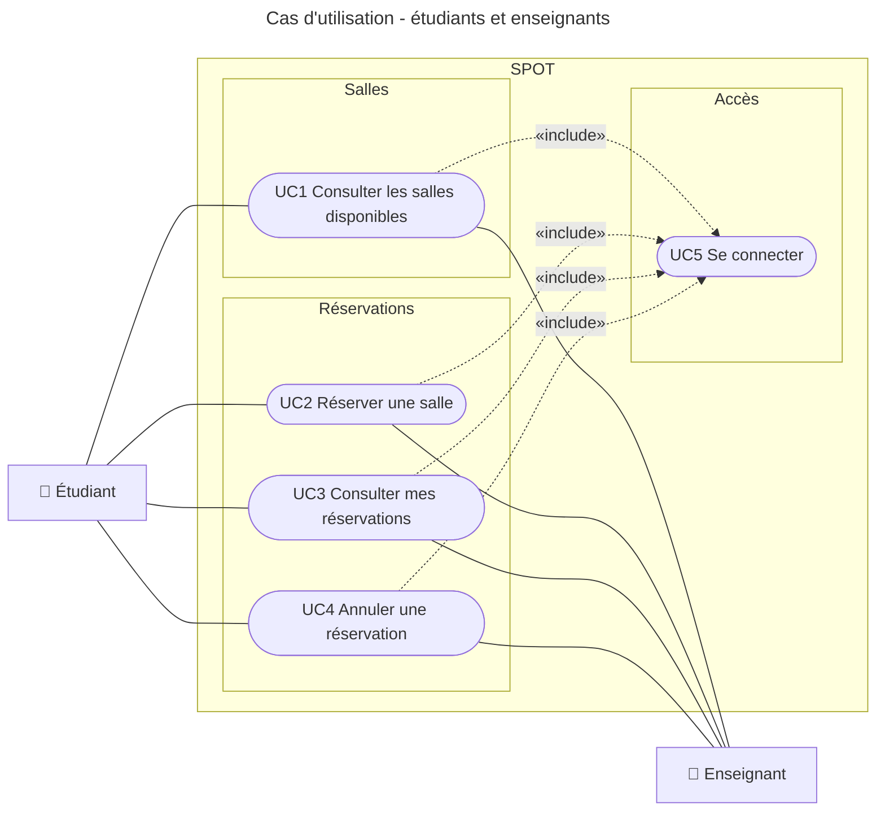
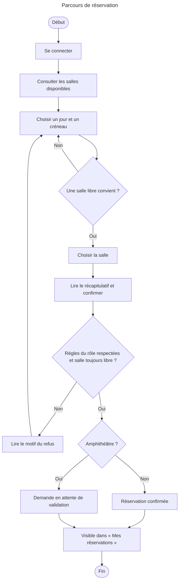

# Cas d'utilisation : étudiants et enseignants

Ce document décrit ce que les étudiants et les enseignants font avec SPOT : consulter les salles, réserver, retrouver leurs réservations et annuler.

Il s'appuie sur la [collecte d'information](https://github.com/maximilianpw/spot/blob/docs/collecte-information/docs/projet/01-decouverte/collecte-information/synthese.md). Les cas du responsable des salles et de l'accueil sont traités dans l'issue #18.

## Acteurs

| Acteur     | Qui                                        | Appareil principal | Ce qu'il attend                                              |
| ---------- | ------------------------------------------ | ------------------ | ------------------------------------------------------------ |
| Étudiant   | Élève de l'école, d'abord la classe pilote | Téléphone          | Trouver une salle libre et la réserver en moins d'une minute |
| Enseignant | Intervenant ou enseignant référent         | Ordinateur         | Réserver pour une soutenance, un rattrapage ou une réunion   |

## Diagramme de cas d'utilisation

Les deux acteurs ont les mêmes cas d'utilisation. Ce qui les distingue, ce sont les règles appliquées pendant la réservation (voir [Règles par rôle](#règles-par-rôle)).

UC5 « Se connecter » est une étape commune aux quatre autres cas. Son détail relève du contrat d'API des comptes et rôles (#20).

## Règles par rôle

| Règle                  | Étudiant                  | Enseignant                                                |
| ---------------------- | ------------------------- | --------------------------------------------------------- |
| Salles réservables     | Salles de projet          | Toutes ; l'amphithéâtre après validation                  |
| Durée maximale         | 2 h                       | À confirmer avec le client (#10)                          |
| Créneaux de cours      | Non réservables           | Non réservables                                           |
| Chevauchement          | Interdit                  | Interdit                                                  |
| Annulation             | Jusqu'au début du créneau | Jusqu'au début du créneau                                 |
| Réservation après 19 h | À confirmer (#10)         | Connue de l'accueil avant 17 h ; détail à confirmer (#10) |

## Fiches des cas d'utilisation

### UC1 : Consulter les salles disponibles

- **Acteur principal :** étudiant ou enseignant.
- **But :** savoir quelles salles sont libres, sans faire le tour des étages ni envoyer d'e-mail.
- **Précondition :** l'acteur est connecté (UC5).
- **Résultat :** l'acteur voit les salles qu'il a le droit de réserver, avec leur capacité, leurs équipements et leur disponibilité.

**Scénario principal**

1. L'acteur demande la liste des salles.
2. SPOT affiche les salles que le rôle de l'acteur peut réserver, avec capacité, équipements et disponibilité à l'instant présent.
3. L'acteur choisit un jour et un créneau.
4. SPOT met à jour la disponibilité de chaque salle pour ce créneau.

**Variantes**

- 2a. Aucune salle n'est réservable pour ce rôle : SPOT l'indique.
- 4a. Aucune salle n'est libre sur le créneau : SPOT l'indique et l'acteur choisit un autre créneau.
- 4b. Une salle est prise par un cours : SPOT l'affiche comme indisponible, sans détail sur le cours.

### UC2 : Réserver une salle

- **Acteur principal :** étudiant ou enseignant.
- **But :** obtenir une salle sur un créneau, avec la certitude que personne d'autre ne l'a.
- **Précondition :** l'acteur est connecté (UC5).
- **Garantie minimale :** aucune réservation n'est enregistrée si une règle est refusée ; jamais deux réservations sur des créneaux qui se chevauchent pour une même salle.
- **Résultat :** la réservation est enregistrée et apparaît dans « Mes réservations » (UC3).
- **Objectif mesuré :** moins d'une minute entre l'ouverture de l'application et la confirmation.

**Scénario principal**

1. L'acteur choisit une salle et un créneau (depuis UC1).
2. SPOT présente le récapitulatif : salle, jour, heure de début et de fin.
3. L'acteur confirme.
4. SPOT vérifie les règles du rôle et la disponibilité de la salle.
5. SPOT enregistre la réservation et affiche la confirmation.

**Variantes**

- 4a. La salle n'est pas réservable par ce rôle : SPOT refuse et explique pourquoi.
- 4b. La durée dépasse le maximum du rôle (2 h pour un étudiant) : SPOT refuse et rappelle la durée autorisée.
- 4c. Le créneau recouvre un cours : SPOT refuse et propose de choisir un autre créneau.
- 4d. Quelqu'un vient de réserver la salle sur ce créneau : SPOT refuse et renvoie l'acteur vers les salles libres (UC1).
- 4e. L'enseignant demande l'amphithéâtre : SPOT enregistre une demande en attente et prévient l'acteur qu'elle doit être validée par le responsable des salles (voir #18).
- À tout moment avant l'étape 3, l'acteur abandonne : rien n'est enregistré.

### UC3 : Consulter mes réservations

- **Acteur principal :** étudiant ou enseignant.
- **But :** retrouver où et quand il a une salle.
- **Précondition :** l'acteur est connecté (UC5).
- **Résultat :** l'acteur voit ses réservations à venir, de la plus proche à la plus lointaine.

**Scénario principal**

1. L'acteur demande ses réservations.
2. SPOT affiche les réservations à venir de l'acteur : salle, jour, créneau et état (confirmée, en attente de validation).

**Variantes**

- 2a. L'acteur n'a aucune réservation à venir : SPOT l'indique et propose de consulter les salles (UC1).

### UC4 : Annuler une réservation

- **Acteur principal :** étudiant ou enseignant.
- **But :** libérer une salle dont il n'a plus besoin, pour qu'elle ne reste pas « réservée mais vide ».
- **Précondition :** l'acteur est connecté (UC5) et a une réservation dont le créneau n'a pas commencé.
- **Garantie minimale :** un acteur ne peut annuler que ses propres réservations.
- **Résultat :** la réservation est annulée et le créneau redevient libre pour les autres.

**Scénario principal**

1. L'acteur choisit une de ses réservations (depuis UC3) et demande son annulation.
2. SPOT demande confirmation.
3. L'acteur confirme.
4. SPOT annule la réservation, libère le créneau et affiche la liste mise à jour.

**Variantes**

- 1a. Le créneau a déjà commencé : SPOT ne propose pas l'annulation.
- 3a. L'acteur renonce : la réservation est conservée.
- 4a. Le créneau a commencé entre-temps : SPOT refuse et l'explique.

## Parcours de réservation

Les motifs de refus sont ceux des variantes 4a à 4d de UC2.

## Questions ouvertes

Ces points dépendent des réponses du client (#10). Les fiches seront mises à jour quand elles seront connues.

- Durée maximale d'une réservation pour un enseignant.
- Priorité des enseignants sur les étudiants pour les examens : s'applique-t-elle à une réservation étudiante déjà confirmée ?
- Réservations du soir : que se passe-t-il pour une demande après 19 h faite après 17 h ?
- Un étudiant peut-il avoir plusieurs réservations à venir en même temps ?
